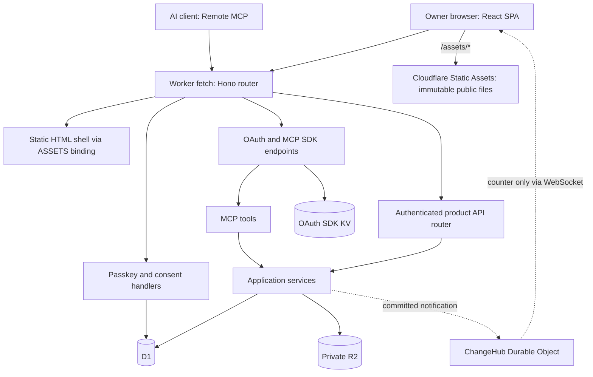

# Agent Whiteboard — Final Architecture

Architecture baseline: 2026-11-03 (audit corrections applied). “Final” identifies the selected structure and contracts for the next implementation stage; it does not mean the product is complete.

## 1. Product and scope

Agent Whiteboard is a single-owner, self-hosted handwriting peripheral for existing AI agents. The owner writes in a browser, commits a rendered answer, and an OAuth-authorized MCP client retrieves that answer and appends feedback.

The core model is:

**One Problem → one persistent Canvas → multiple immutable Snapshots → append-only Feedback.**

There is no built-in LLM, model API key, chat system, automatic grader, background agent orchestration, multiplayer collaboration, or separate follow-up canvas. Product behavior is defined in the [specification](specification.md).

## 2. Current implementation status

| Area                                                            | Status in this repository                                                        |
| --------------------------------------------------------------- | -------------------------------------------------------------------------------- |
| Passkey owner authentication, bootstrap/recovery, Web sessions  | Implemented; existing server logic retained                                      |
| OAuth consent, scopes, epoch checks, grant listing/revocation   | Implemented; exercised in local integration tests                                |
| React account pages                                             | Implemented in the same client-rendered React SPA as the product entry           |
| Worker routing, assets, build/deploy scripts, auth migrations   | Implemented                                                                      |
| Browser API and four MCP tool definitions                       | Wired to shared service contracts; input validation and body budgets implemented |
| Product DTOs, domain errors, operational limits, Web API client | Implemented                                                                      |
| Product database schema and services                            | Pending; all service methods throw `not_implemented`                             |
| Product React UI and canvas adapter                             | Pending; `App` is an empty entry                                                 |
| ChangeHub, change counter and long-poll services                | Interfaces only; not operational                                                 |
| Export/restore, object collection, complete product acceptance  | Pending                                                                          |

Local tests establish the foundation's behavior, not the correctness of future product persistence. Physical-device Passkey testing and deployment validation of this React-auth revision remain release checks.

## 3. Runtime topology

One Cloudflare Worker exports a Hono application as its fetch handler. Hono owns the route tree for pages, account APIs, product APIs and SDK protocol endpoints. Matching `/assets/*` files are served directly by Cloudflare Static Assets, without invoking the Worker or querying D1. There is no outer authentication dispatcher or external auth service.



D1 is authoritative for structured state and committed pointers. R2 holds objects. OAuth KV is owned by the OAuth SDK. ChangeHub is a delivery mechanism, never the authority for canvas state or commit success.

## 4. Source boundaries

| Path                          | Responsibility                                                                          |
| ----------------------------- | --------------------------------------------------------------------------------------- |
| `src/server/index.ts`         | Hono top-level route table and Worker entry                                             |
| `src/server/middleware.ts`    | Request context, sessions, CSRF, rate limits and security headers                       |
| `src/server/auth/`            | Passkey ceremonies, consent/grant handlers and OAuth SDK integration; no HTML rendering |
| `src/server/http/`            | Shared bounded body readers and stable HTTP/MCP application error mapping               |
| `src/shared/pages.ts`         | Page registry shared by Hono and React                                                  |
| `src/server/routes/`          | Static SPA shell handler and mounted product API router                                 |
| `src/server/mcp/`             | Tool definitions, scope checks, service dispatch and image content blocks               |
| `src/server/services/`        | Shared product service interfaces; future business invariants                           |
| `src/server/env.ts`, `hub.ts` | Bindings/request context and notification-only Durable Object interface                 |
| `src/web/main.tsx`, `App.tsx` | Single browser entry and page selection                                                 |
| `src/web/auth/`               | Browser-only React account pages and CSS                                                |
| `src/web/api.ts`              | Typed product API client                                                                |
| `src/shared/`                 | DTOs, consent API types, input schemas, errors and limits                               |
| `src/tooling/`                | Build, provisioning/deployment and maintenance entry                                    |
| `migrations/`                 | Ordered D1 migrations; `0001`–`0003` belong to auth                                     |

Services must not depend on HTTP requests, Hono contexts or MCP servers. Transport adapters must not implement competing versions of the save/submit state machine. Browser components never import database or server authentication modules. The Worker never imports React components.

`src/web/canvas/assets.ts` already defines local drawing asset URLs. As product implementation grows, extend that directory with the thin tldraw adapter. Add `src/web/sync/` for local persistence/save queues and focused service/repository modules as needed. These directories are planned boundaries, not empty scaffolding that must be populated in advance. No generic repository framework or multi-package platform is required.

## 5. Authentication and React SPA

Hono middleware resolves the owner and checks same-origin mutations before private handlers run. Web requests use an HttpOnly secure session cookie. MCP uses OAuth, `mcp:read`, additional `mcp:write` for mutation tools, current auth epoch and per-grant revocation checks. The OAuth SDK handles only the explicitly mounted protocol routes; it does not wrap the application.

Account pages and the product entry share one client-rendered React application. Hono serves the same static HTML shell for known page URLs from the shared page registry. Cloudflare serves public hashed JS/CSS under `/assets/*` directly. Private data comes from protected APIs. There is no SSR, hydration, dedicated auth bundle or inline script injection.

Passkey interactions call browser APIs, then send results to backend verification. The consent page fetches validated OAuth context from `POST /auth/consent`, submits its decision to `POST /authorize`, and follows the server-returned, SDK-validated redirect. Consent handles, cookies, scopes, Origin and session checks remain server-enforced. React escapes external display text; no private data is embedded in the HTML shell.

OAuth integration receives an authenticated MCP handler from the root router. It imports no product services or MCP tool implementation. The request's auth-state snapshot is reused for token/grant validation and metadata; revocation still requires its own authoritative D1 lookup. There is no cross-request authorization cache. Consent submission receives the session already checked by middleware, and `mcp:read` is mandatory in both UI and server validation. `/setup` is rate limited and skips bootstrap initialization writes once setup is complete.

HTML and default API responses use `no-store`. Fingerprinted static assets use `public, max-age=31536000, immutable` through `_headers`. Explicit route cache policies survive middleware, including private immutable Snapshot images: once implemented, such images may remain in the owner's browser cache after session revocation. Their URLs must identify immutable content. Unknown asset paths and direct `/index.html` requests return 404.

Auth source is a maintained Whiteboard adaptation of the upstream template. Updates are reviewed merges, not source synchronization. See [Authentication](auth-integration.md) for the route table and lifecycle.

## 6. Data ownership

| State                                                                     | Authority / intended storage                                           |
| ------------------------------------------------------------------------- | ---------------------------------------------------------------------- |
| Owner, sessions, Passkeys, canonical origin, auth epoch, revocation index | D1; implemented                                                        |
| OAuth grants/tokens and SDK metadata                                      | OAuth SDK KV; implemented                                              |
| Collections, sets, problems, Canvas revision pointers                     | D1; pending                                                            |
| Versioned Canvas documents and immutable Snapshot images                  | Private R2; pending                                                    |
| Snapshot sequence/latest pointer, feedback and idempotency records        | D1; pending                                                            |
| Server change counter                                                     | D1, advanced with visible product mutations; pending                   |
| Unacknowledged local strokes and conflict recovery copies                 | Browser IndexedDB; pending                                             |
| Per-problem camera, active tool/color and current selection               | Browser session/local recovery state; excluded from answer fingerprint |
| Persisted user preferences                                                | Preferences service; storage implementation pending                    |

Snapshots carry stable IDs, per-problem monotonic sequence, source revision and creation time. Feedback explicitly references a Snapshot and must also belong to that Snapshot's Problem. Database constraints must prevent cross-problem references and duplicate sequence numbers.

The transport Canvas document contains tldraw store records and schema. The storage implementation must additionally record the pinned engine version, validate supported records and compute a canonical answer fingerprint. A permissive transport object is not sufficient validation for persisted canvas content.

## 7. Draft save and submission consistency

The following are required implementation invariants, not claims about the current service stubs.

### Draft save

1. Persist an unacknowledged local copy before relying on the network. Serialize saves per Problem and tag responses with the exact local version they confirm.
2. Save with `base_revision` and `edit_epoch`. The server rejects stale revision, stale epoch, or a Ready canvas.
3. Upload the document under a new immutable R2 key, then conditionally advance the D1 pointer and revision.
4. Recheck auth epoch inside the database mutation. Initial request authentication alone is insufficient for in-flight requests crossing recovery.
5. A conflict preserves the local document and offers reload/export recovery; it never silently overwrites the remote canvas.

“Saved” means the server acknowledged the current content. “Stored locally” and “saved remotely” are different states.

### Mark ready

```mermaid
sequenceDiagram
    participant UI as Browser
    participant S as Submission service
    participant R as Private R2
    participant D as D1
    participant H as ChangeHub
    UI->>UI: Freeze one document for save and export
    UI->>S: Save document; obtain revision
    UI->>S: Commit PNG + revision + edit epoch + idempotency key
    S->>R: Store immutable image object
    S->>D: Guard and atomically commit Snapshot, sequence, latest pointer, Ready, idempotency and counter
    D-->>S: Committed result
    S-->>UI: Ready confirmation
    S-->>H: Best-effort notification of committed counter
```

D1 commit is the publication boundary. R2 upload success alone is not a submitted answer. A conditional SQL statement matching zero rows must not leave a partial Snapshot through other statements in the same batch. Atomicity and failed-condition behavior must be demonstrated using D1 integration tests before the service is accepted.

On unknown outcomes, retry the same idempotency key and recover the original result. Scope keys to the operation and input fingerprint; reject same-key/different-input retries. Never use a Worker memory lock or an unguarded `MAX(sequence) + 1` read as concurrency control.

If current answer content equals the latest Snapshot fingerprint, reuse that Snapshot. Camera, selection, tools and question presentation do not change the answer fingerprint. Removing every answer stroke does not reuse a previous nonempty image. New submissions must include full drawing content, not the viewport.

Resume advances the edit epoch only for the actual Ready → Working transition. A repeat request while already Working returns the existing epoch. Previously queued saves cannot become valid just because the canvas has been unlocked again.

### Failure boundaries

| Failure                            | Required result                                                                                          |
| ---------------------------------- | -------------------------------------------------------------------------------------------------------- |
| Local export or R2 upload fails    | Remain Working; preserve local drawing; permit retry                                                     |
| R2 succeeds, D1 rejects/fails      | No published Snapshot; allow an unreferenced object pending safe cleanup                                 |
| D1 commits, HTTP response is lost  | Retry resolves through the idempotency record                                                            |
| D1 commits, ChangeHub notify fails | Commit stays successful; record notification failure without exposing content; catch-up finds the change |
| Revision/epoch mismatch            | Preserve local recovery copy and return the appropriate conflict                                         |
| Recovery races a mutation          | Database auth guard rejects the old request                                                              |

Object collection must exclude referenced and in-flight objects and use a retention window. Do not delete an object merely because no reference appears immediately after upload. Product garbage collection and export/restore remain pending.

## 8. Reading submissions and displaying feedback

`get_submission` selects the latest committed Snapshot on the server, then reads its immutable object key. It never renders the live draft. The initial database implementation must use a consistent primary read path; introducing replicas later requires an explicit cross-client read-after-write design.

A resumed canvas can coexist with a retrievable older Snapshot. Responses state `answer_state` and whether the server-known draft differs from the latest committed answer. Offline local strokes are outside that claim.

Feedback is append-only and tied to the supplied Snapshot. Multiple entries for one Snapshot are valid. The latest graded entry determines that Snapshot's effective verdict; an ungraded comment does not clear it. Trend compares distinct graded Snapshots. Historical feedback must not overwrite the displayed state of a newer, unreviewed answer.

Use one shared pure derivation module when implementing these states, so Overview, Review and MCP summaries agree.

## 9. Live updates

The selected transport is a notification-only WebSocket to one ChangeHub per deployment, with change-counter catch-up and bounded long-poll fallback. This supersedes the earlier polling-only implementation proposal.

The payload is only `{ type: "changed", seq }`. Pages retrieve actual data through authenticated routes. D1 assigns the counter with committed product mutations; hub delivery may repeat, arrive out of order or fail. Clients reconcile using the authoritative counter rather than counting notifications.

The future browser connection flow must establish its subscription and then read the current counter, reconcile after reconnect, and periodically recheck even while connected so a missed post-commit notification cannot leave an indefinitely stale UI. Remote updates never switch the active problem, change the camera or interrupt a pen stroke.

The hub must enforce auth-epoch changes and define bounded socket lifetime/revalidation; an initial handshake does not authorize an indefinite connection. No private content is sent over it. The current hub is a stub, so these guarantees still require implementation and tests.

## 10. Transport contracts and budgets

Inputs and results are centralized in `src/shared/schemas.ts` and `model.ts`. Create destinations have enforced exclusive choices at both Set and Collection levels. The browser list client forwards filters and cursors rather than silently fetching only the first 100 records.

MCP has an 8 MiB body budget; canvas JSON, PNG and preferences have 4 MiB, 8 MiB and 16 KiB budgets respectively. Shared HTTP body readers count streamed bytes before full buffering and reject invalid UTF-8. HTTP and MCP application errors share stable codes plus human-readable messages; OAuth protocol errors retain SDK codes and `error_description`. Auth/OAuth requests retain their separate 64 KiB limit. Field-level limits apply in addition to body budgets. See [API contracts](api.md).

## 11. Build, formatting, deployment and documentation

Vite emits the shared SPA HTML and ordinary hashed JS/CSS assets. The build also copies the pinned tldraw fonts, icons and translations to versioned local asset URLs, verified against the engine version. The future canvas must pass `canvasAssetUrls` to tldraw; complete canvas/CSP validation remains pending. Account styles are scoped to `.auth-page`. A separate Worker bundle is generated for integration tests. Node.js 22.12+ is required. Deployment always rebuilds successfully before any migration, provisioning or publishing, and uses the same source and ordered migrations, provisioning missing resources through a maintenance-only Worker before publishing the application.

`docs/` is public and tracked. `internal/docs/` contains local planning and historical evidence and is ignored, along with experiments, prototypes and private deployment data. Public instructions must work without any ignored file or neighboring template checkout. Old Access/cf setup guides and the template source-copy workflow are retired.

Prettier formats maintained source, tests, configuration and public Markdown. `npm run format` writes formatting; `npm run format:check` verifies it. Generated assets, local experiments, internal records and immutable migrations are excluded.

See [Deployment](deployment.md) and [Development](development.md) for commands and validation boundaries.

## 12. Next implementation sequence

1. Add product migrations, uniqueness/ownership constraints and service write guards; prove D1 commit behavior under conflicts and failures.
2. Implement the thin canvas adapter and IndexedDB-backed serial save queue using the established interaction requirements.
3. Implement idempotent Snapshot commit/resume and authenticated image reads.
4. Implement the four MCP services and append-only feedback, then complete a real client round trip.
5. Implement ChangeHub delivery/catch-up and remaining product UI without disturbing active handwriting.
6. Complete device, deployment, backup/restore and failure-recovery acceptance before describing the product as usable.
