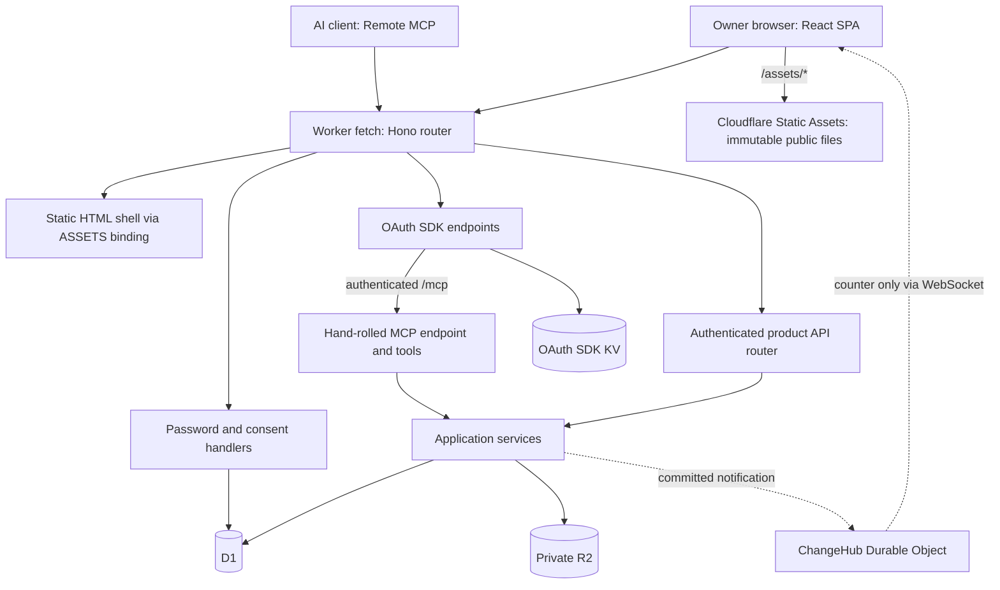

# InkLoop — Final Architecture

Architecture and implementation status reviewed against source on 2026-11-04. “Final” identifies the selected structure and contracts; release acceptance remains incomplete.

## 1. Product and scope

InkLoop is a single-owner, self-hosted handwriting peripheral for existing AI agents. The owner writes in a browser, commits a rendered answer, and an OAuth-authorized MCP client retrieves that answer and appends feedback.

The core model is:

**One Problem → one persistent Canvas → multiple immutable Snapshots → append-only Feedback.**

There is no built-in LLM, model API key, chat system, automatic grader, background agent orchestration, multiplayer collaboration, or separate follow-up canvas. Product behavior is defined in the [specification](specification.md).

## 2. Current implementation status

| Area                                                            | Status in this repository                                                            |
| --------------------------------------------------------------- | ------------------------------------------------------------------------------------ |
| Owner password sign-in, setup/recovery keys, Web sessions       | Implemented; Passkeys were replaced by passwords in `0005_password.sql`              |
| OAuth consent, scopes, epoch checks, grant listing/revocation   | Implemented; exercised in local integration tests                                    |
| React account pages                                             | Implemented in the same client-rendered React SPA as the product entry               |
| Worker routing, assets, build/deploy scripts, auth migrations   | Implemented                                                                          |
| Browser API and 13 MCP tool definitions                         | Implemented over shared product services; input validation and body budgets enforced |
| Product DTOs, domain errors, operational limits, Web API client | Implemented                                                                          |
| Product database schema and services                            | Implemented (`0004_product.sql`, `src/server/services/`); D1 integration tests       |
| Product React UI and canvas adapter                             | Implemented; POC board ported to React components over a thin tldraw adapter         |
| ChangeHub, change counter and long-poll services                | Implemented; WebSocket, catch-up and long-poll covered by local tests                |
| Local drafts, serial save queue, conflict recovery              | Implemented (IndexedDB, `src/web/sync/`)                                             |
| Installable PWA and offline board reads                         | Implemented (`src/sw/sw.ts`, `src/web/pwa.ts`); local service-worker tests           |
| Export/restore, object collection                               | Pending                                                                              |

Local tests run the real Worker, D1, R2 and ChangeHub in Miniflare, including concurrent commits, idempotent retries and stale-epoch rollback. The [production CPU run](experiments/performance-production-2026-11-04.md) exercised real OAuth-authorized MCP reads, creation, updates and deletion with D1 persistence. Repeated reauthorization occurred during that run and has not recurred since. A deployed instance has also run the complete loop with a real AI client over OAuth: problems created through MCP, handwritten on a physical iPad, marked ready, read with `get_submission`, reviewed with `append_feedback`, revised and reviewed again. First-install/upgrade acceptance remains a release check.

## 3. Runtime topology

One Cloudflare Worker exports a Hono application as its fetch handler. Hono owns the route tree for pages, account APIs, product APIs, OAuth SDK protocol endpoints and the MCP endpoint. Matching `/assets/*` files are served directly by Cloudflare Static Assets, without invoking the Worker or querying D1. There is no outer authentication dispatcher or external auth service.



D1 is authoritative for structured state and committed pointers. R2 holds objects. OAuth KV is owned by the OAuth SDK. ChangeHub is a delivery mechanism, never the authority for canvas state or commit success.

## 4. Source boundaries

| Path                          | Responsibility                                                                        |
| ----------------------------- | ------------------------------------------------------------------------------------- |
| `src/server/index.ts`         | Hono top-level route table and Worker entry                                           |
| `src/server/middleware.ts`    | Request context, sessions, CSRF, rate limits and security headers                     |
| `src/server/auth/`            | Password sign-in, consent/grant handlers and OAuth SDK integration; no HTML rendering |
| `src/server/http/`            | Shared bounded body readers and stable HTTP/MCP application error mapping             |
| `src/shared/pages.ts`         | Page registry shared by Hono and React                                                |
| `src/server/routes/`          | Static SPA shell handler and mounted product API router                               |
| `src/server/mcp/`             | Stateless MCP endpoint, tool definitions, input validators, scope checks and dispatch |
| `src/server/services/`        | Product services, business invariants and guarded D1/R2 operations                    |
| `src/server/env.ts`, `hub.ts` | Bindings/request context and notification-only Durable Object interface               |
| `src/web/main.tsx`, `App.tsx` | Single browser entry and page selection                                               |
| `src/web/auth/`               | Browser-only React account pages and CSS                                              |
| `src/web/api.ts`              | Typed product API client                                                              |
| `src/web/board/`              | Product board: controller, React components ported from the POC, math rendering       |
| `src/web/canvas/`             | Thin tldraw adapter: document load/capture, answer fingerprint, PNG export, gestures  |
| `src/web/sync/`               | IndexedDB drafts, per-problem serial save queue, change feed                          |
| `src/shared/`                 | DTOs, consent API types, input schemas, errors and limits                             |
| `src/tooling/`                | Build, provisioning/deployment and maintenance entry                                  |
| `migrations/`                 | Ordered D1 migrations; `0001`–`0003` belong to auth                                   |

Services must not depend on HTTP requests, Hono contexts or MCP servers. Transport adapters must not implement competing versions of the save/submit state machine. Browser components never import database or server authentication modules. The Worker never imports React components.

The board's components keep the POC's markup, class names and stylesheet; the POC constrains the interface, not the code behind it. One tldraw editor shows one Problem's document at a time and swaps documents on navigation. The controller (`src/web/board/controller.ts`) owns state and actions; components only render it. While a pen stroke is in progress the board store holds updates and applies them when the pen lifts. Services are split per area (`problems`, `canvas`, `submissions`, `feedback`, `preferences`, `changes`) with shared D1 helpers in `store.ts`; there is no generic repository framework.

## 5. Authentication and React SPA

Hono middleware resolves the owner and checks same-origin mutations before private handlers run. Web requests use an HttpOnly secure session cookie. MCP uses OAuth, `mcp:read`, additional `mcp:write` for mutation tools, current auth epoch and per-grant revocation checks. The OAuth SDK handles only the explicitly mounted protocol routes; it does not wrap the application.

Account pages and the product entry share one client-rendered React application. Hono serves the same static HTML shell for known page URLs from the shared page registry. Cloudflare serves public hashed JS/CSS under `/assets/*` directly. Private data comes from protected APIs. There is no SSR, hydration, dedicated auth bundle or inline script injection.

The sign-in pages stretch the password in the browser (PBKDF2-SHA256) and send only the stretched value; see [Authentication](auth-integration.md#owner-lifecycle). The consent page fetches validated OAuth context from `POST /auth/consent`, submits its decision to `POST /authorize`, and follows the server-returned, SDK-validated redirect. Consent handles, cookies, scopes, Origin and session checks remain server-enforced. React escapes external display text; no private data is embedded in the HTML shell.

OAuth integration receives an authenticated MCP handler from the root router. It imports no product services or MCP tool implementation. The request's auth-state snapshot is reused for token/grant validation and metadata; revocation still requires its own authoritative D1 lookup. There is no cross-request authorization cache. Consent submission receives the session already checked by middleware, and `mcp:read` is mandatory in both UI and server validation. `/setup` is rate limited and skips bootstrap initialization writes once setup is complete.

HTML and default API responses use `no-store`. Fingerprinted static assets use `public, max-age=31536000, immutable` through `_headers`. Explicit route cache policies survive middleware, including private immutable Snapshot images: such images may remain in the owner's browser cache after session revocation. Their URLs must identify immutable content. Unknown asset paths and direct `/index.html` requests return 404.

Auth source is a maintained InkLoop adaptation of the upstream template. Updates are reviewed merges, not source synchronization. See [Authentication](auth-integration.md) for the route table and lifecycle.

### Installed app and offline storage

The browser registers `/sw.js`; Cloudflare Static Assets serves it and `/manifest.webmanifest` with `no-cache` revalidation. The service worker precaches the board's required assets and matching shell before installation completes. It does not force activation over open pages; older assets are pruned when the new version activates.

Board navigation uses the network and falls back to the cached shell only when the network is unreachable. Selected board GETs (collections, preferences, problem lists/details and Snapshot images) keep their latest successful responses for offline fallback. Canvas recovery uses acknowledged documents and revisions in IndexedDB rather than service-worker response caching. Writes, account pages, OAuth, MCP and live updates require the network. Offline copies are device-local data, not fresh server authorization or a backup. Signing out clears cached board responses and acknowledged Canvas copies; unsent recovery drafts are managed separately. A 401 clears cached board responses.

## 6. Data ownership

| State                                                                              | Authority / intended storage                                           |
| ---------------------------------------------------------------------------------- | ---------------------------------------------------------------------- |
| Owner, sessions, password verifier, canonical origin, auth epoch, revocation index | D1                                                                     |
| OAuth grants/tokens and SDK metadata                                               | OAuth SDK KV; implemented                                              |
| Collections, sets, problems, Canvas revision pointers and fingerprints             | D1                                                                     |
| Versioned Canvas documents (stored verbatim) and Snapshot images (base64)          | Private R2; the current and previous Canvas revision are kept          |
| Snapshot sequence/latest pointer, feedback and idempotency records                 | D1                                                                     |
| Server change counter                                                              | D1, advanced with visible product mutations                            |
| Unacknowledged local strokes and conflict recovery copies                          | Browser IndexedDB                                                      |
| Per-problem camera, active tool/color and current selection                        | Browser session/local recovery state; excluded from answer fingerprint |
| Persisted user preferences                                                         | D1 `preferences`, cached in browser local storage                      |

Snapshots carry stable IDs, per-problem monotonic sequence, source revision and creation time. Feedback explicitly references a Snapshot and must also belong to that Snapshot's Problem. Database constraints must prevent cross-problem references and duplicate sequence numbers.

The Canvas document is a tldraw store snapshot: records plus the schema versions they were written with. The browser validates it against the pinned engine schema and computes the canonical answer fingerprint before upload. The Worker stores the document verbatim and never parses it; see [Canvas trust boundary](#canvas-trust-boundary).

## 7. Draft save and submission consistency

The services implement these invariants; `tests/product.test.mjs` exercises them against local D1 and R2.

### Draft save

1. Persist an unacknowledged local copy before relying on the network. Serialize saves per Problem and tag responses with the exact local version they confirm.
2. Validate the document and compute its answer fingerprint in the browser. Save with `base_revision`, `edit_epoch` and the fingerprint as query parameters and the document as the body. The server rejects stale revision, stale epoch, or a Ready canvas.
3. Stream the body under a new immutable R2 key without parsing it, then conditionally advance the D1 pointer, revision and fingerprint.
4. Recheck auth epoch inside the database mutation. Initial request authentication alone is insufficient for in-flight requests crossing recovery.
5. A conflict preserves the local document and offers reload/export recovery; it never silently overwrites the remote canvas.

“Saved” means the server acknowledged the current content. “Stored locally” and “saved remotely” are different states.

### Canvas trust boundary

Only the owner's browser session writes Canvas documents; MCP has no canvas tool. The deployment has one owner, so the server trusts that session for document content and keeps every check that protects consistency.

The Worker enforces, without reading the document: owner session and same-origin `Origin`; the auth epoch inside the D1 transaction; the 4 MiB size limit from `Content-Length`; the conditional `base_revision`/`edit_epoch` update; and the Ready lock. Concurrent devices therefore cannot overwrite each other, and a stale or revoked session cannot write.

The browser is responsible for content: the document must load under the pinned tldraw schema, and the fingerprint must describe its answer records (camera, selection and tool state excluded, as in §6). Parsing and validating the document in the Worker would cost CPU proportional to its size on every autosave, against the 10 ms Workers Free budget.

Consequences of trusting the browser, and their mitigations:

- **Invalid or unwanted content** affects only the owner's own Canvas. Every revision is a separate immutable R2 object, so the client can fall back to the previous revision. tldraw validates and migrates records again when a document loads.
- **A wrong fingerprint** affects Snapshot reuse. Reporting "changed" for unchanged content only creates a redundant Snapshot. Reporting "unchanged" for changed content would reuse an older Snapshot, so the agent reviews a stale answer. To keep this to client bugs, the browser computes the fingerprint and the export from the same frozen document.
- **External references** are excluded at the editor: shapes and paste handlers that load external URLs (images, video, embeds, bookmarks) are disabled, so a stored document cannot make the owner's browser fetch third-party content.

### Mark ready

```mermaid
sequenceDiagram
    participant UI as Browser
    participant S as Submission service
    participant R as Private R2
    participant D as D1
    participant H as ChangeHub
    UI->>UI: Freeze one document for save and export
    UI->>S: Save document; obtain revision
    UI->>S: Commit base64 PNG + revision + edit epoch + idempotency key
    S->>R: Stream immutable base64 image object
    S->>D: Guard and atomically commit Snapshot, sequence, latest pointer, Ready, idempotency and counter
    D-->>S: Committed result
    S-->>UI: Ready confirmation
    S-->>H: Best-effort notification of committed counter
```

D1 commit is the publication boundary. R2 upload success alone is not a submitted answer. A conditional SQL statement matching zero rows must not leave a partial Snapshot through other statements in the same batch. Atomicity and failed-condition behavior must be demonstrated using D1 integration tests before the service is accepted.

On unknown outcomes, retry the same idempotency key and recover the original result. Scope keys to the operation and input fingerprint; reject same-key/different-input retries. Never use a Worker memory lock or an unguarded `MAX(sequence) + 1` read as concurrency control.

If current answer content equals the latest Snapshot fingerprint, reuse that Snapshot. Camera, selection, tools and question presentation do not change the answer fingerprint. Removing every answer stroke does not reuse a previous nonempty image. New submissions must include full drawing content, not the viewport.

Resume advances the edit epoch only for the actual Ready → Working transition. A repeat request while already Working returns the existing epoch. Previously queued saves cannot become valid just because the canvas has been unlocked again.

### Failure boundaries

| Failure                            | Required result                                                                                          |
| ---------------------------------- | -------------------------------------------------------------------------------------------------------- |
| Local export or R2 upload fails    | Remain Working; preserve local drawing; permit retry                                                     |
| R2 succeeds, D1 rejects/fails      | No published Snapshot; allow an unreferenced object pending safe cleanup                                 |
| D1 commits, HTTP response is lost  | Retry resolves through the idempotency record                                                            |
| D1 commits, ChangeHub notify fails | Commit stays successful; record notification failure without exposing content; catch-up finds the change |
| Revision/epoch mismatch            | Preserve local recovery copy and return the appropriate conflict                                         |
| Recovery races a mutation          | Database auth guard rejects the old request                                                              |

Object collection must exclude referenced and in-flight objects and use a retention window. Do not delete an object merely because no reference appears immediately after upload. Product garbage collection and export/restore remain pending.

## 8. Reading submissions and displaying feedback

`get_submission` selects the latest committed Snapshot on the server, then reads its immutable object key. It never renders the live draft. The initial database implementation must use a consistent primary read path; introducing replicas later requires an explicit cross-client read-after-write design.

A resumed canvas can coexist with a retrievable older Snapshot. Responses state `answer_state` and whether the server-known draft differs from the latest committed answer. Offline local strokes are outside that claim.

Feedback is append-only and tied to the supplied Snapshot. Multiple entries for one Snapshot are valid. The latest graded entry determines that Snapshot's effective verdict; an ungraded comment does not clear it. Trend compares distinct graded Snapshots. Historical feedback must not overwrite the displayed state of a newer, unreviewed answer.

### Snapshot image representation

Each Snapshot image is stored once, in private R2, as the base64 text of its PNG. D1 holds the object key, text length, PNG dimensions and Snapshot metadata, never the image itself. The Worker streams the base64 representation rather than decoding the whole PNG. Upload validation inspects every encoded byte in JavaScript and decodes the short PNG header; reads stream the stored text.

Why base64 in R2:

- MCP carries images as base64 inside JSON. Stored already encoded, the object can be streamed straight into the `get_submission` response. Encoding in the Worker would cost CPU proportional to image size, against the 10 ms Workers Free budget ([Runtime measurements](experiments/performance.md)).
- D1 is unsuitable. A row, string or BLOB is limited to 2 MB, below the 8 MiB Snapshot limit, and a BLOB crosses the D1 binding as a JavaScript array with one number per byte, serialized through JSON. Returning image-sized JavaScript arrays would add serialization and allocation work; this run did not profile its CPU cost.
- One stored representation avoids keeping a PNG and a base64 copy consistent. The cost is 4/3 storage and upload size.

Write path: the browser encodes the exported PNG (browser CPU costs nothing against the Worker budget) and uploads the text with a `Content-Length`. The Worker checks the length against the limit, decodes only the first 32 characters (24 bytes: PNG signature and IHDR width/height) to validate the header and dimensions, and pipes the remaining stream into R2 through a fixed-length stream. While streaming it checks that every byte is base64 (alphabet, then at most two trailing `=`; the total length is a multiple of 4), because `get_submission` places the stored text verbatim inside a JSON string. An invalid byte aborts the upload, so no object is stored and nothing is committed. It does not decode or hash the image: validation is proportional to encoded image size; its deployed CPU cost remains unmeasured. The commit then follows §7 unchanged.

Read paths:

- `get_submission` serializes its JSON-RPC result with a placeholder for the image `data`, splits the string at the placeholder, and responds with prefix + R2 object stream + suffix and an exact `Content-Length`. Base64 contains no characters that need JSON escaping.
- `GET /api/snapshots/:id/image` returns the stored text unchanged; the browser decodes it for display.

The shared pure derivation module (`src/shared/derive.ts`) keeps Overview, Review and MCP summaries consistent.

## 9. Live updates

The selected transport is a notification-only WebSocket to one ChangeHub per deployment, with change-counter catch-up and bounded long-poll fallback. This supersedes the earlier polling-only implementation proposal.

The payload is only `{ type: "changed", seq }`. Pages retrieve actual data through authenticated routes. D1 assigns the counter with committed product mutations; hub delivery may repeat, arrive out of order or fail. Clients reconcile using the authoritative counter rather than counting notifications.

The browser change feed (`src/web/sync/changeFeed.ts`) establishes its subscription before reading the current counter, reconciles after reconnect, rechecks every 60 seconds while connected and long-polls while the socket is unavailable. This catches missed post-commit notifications. Remote updates never switch the active problem, change the camera or interrupt a pen stroke.

The hub must enforce auth-epoch changes and define bounded socket lifetime/revalidation; an initial handshake does not authorize an indefinite connection. No private content is sent over it. The hub tags each socket with its auth epoch and a one-hour lifetime: a notification from a newer epoch, or an alarm at expiry, closes it and the page reconnects through the authenticated route.

## 10. Transport contracts and budgets

Inputs and results are centralized in `src/shared/schemas.ts` and `model.ts`. Create destinations have enforced exclusive choices at both Set and Collection levels. The browser list client forwards filters and cursors rather than silently fetching only the first 100 records.

MCP has an 8 MiB body budget; canvas JSON, PNG and preferences have 4 MiB, 8 MiB and 16 KiB budgets respectively. Shared HTTP body readers count streamed bytes before full buffering and reject invalid UTF-8. Canvas documents and Snapshot images are budgeted by `Content-Length` and streamed to R2 without full JSON/PNG parsing. Snapshot uploads still inspect each base64 byte, so streaming does not establish size-independent CPU cost. HTTP and MCP application errors share stable codes plus human-readable messages; OAuth protocol errors retain SDK codes and `error_description`. Auth/OAuth requests retain their separate 64 KiB limit. Field-level limits apply in addition to body budgets. See [API contracts](api.md). The [production measurements](experiments/performance-production-2026-11-04.md) recorded 12 of 36 business requests above 10 ms, including persisted creates and listing. Current limits are transport budgets, not a guarantee of Free-plan CPU capacity.

## 11. Build, formatting, deployment and documentation

Vite emits the shared SPA HTML and ordinary hashed JS/CSS assets. The build also copies the pinned tldraw fonts, icons and translations to versioned local asset URLs, verified against the engine version. The canvas passes `canvasAssetUrls` to tldraw. Fonts, MathJax and all other assets are served from `/assets`; Vite never inlines assets as `data:` URLs. The page CSP keeps `script-src 'self'` and allows inline styles (`style-src 'self' 'unsafe-inline'`), because tldraw's license watermark and image export and MathJax's SVG output inject `<style>` elements. Account styles are scoped to `.auth-page`. A separate Worker bundle is generated for integration tests. Node.js 22.12+ is required. Deployment always rebuilds successfully and verifies R2 availability with a read-only bucket-list request before any migration, provisioning or publishing, and uses the same source and ordered migrations, provisioning missing resources through a maintenance-only Worker before publishing the application.

`docs/` is public and tracked. `docs/experiments/` contains public, sanitized experiment reports and performance evidence, with historical scope labels. `internal/docs/` contains private planning and evidence and is ignored, along with root-level experiments, prototypes and private deployment data. Public instructions must work without any ignored file or neighboring template checkout. Old Access/cf setup guides and the template source-copy workflow are retired.

Prettier formats maintained source, tests, configuration and public Markdown. `npm run format` writes formatting; `npm run format:check` verifies it. Generated assets, local experiments, internal records and immutable migrations are excluded.

See [Deployment](deployment.md) and [Development](development.md) for commands and validation boundaries.

## 12. Remaining release work

Data export/restore, and collection of unreferenced R2 objects (failed uploads whose outcome was unknown) with a retention window.
