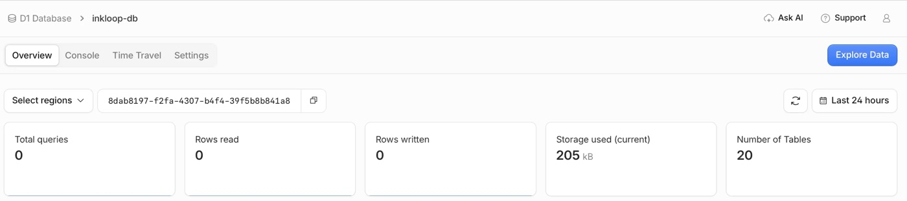

# Deployment and recovery

The repository deploys the complete InkLoop Worker: password sign-in, the handwriting board, canvas and Snapshot storage, feedback, live updates and the OAuth-protected MCP endpoint. Data export/restore and collection of unreferenced R2 objects are not implemented yet; see [Architecture](architecture.md#12-remaining-release-work).

## Requirements

Use Node.js 22.12 or later, the committed npm lockfile, and a Cloudflare account with Workers, D1, KV and R2 available. Use an HTTPS deployment address that can remain stable: owner setup binds sign-in and OAuth to it. No upstream OAuth app, Cloudflare Access policy or model API key is required.

The configuration declares one Worker, a D1 database, an OAuth KV namespace, a private R2 bucket, a SQLite-backed ChangeHub Durable Object and an authentication rate-limit binding. Billing and account availability depend on the deployment's Cloudflare settings; this project does not promise a free operating tier.

### Enable R2 before deploying

An R2 subscription is an account-level prerequisite, separate from automatically creating a bucket. Before the first terminal or Git-connected deployment:

1. Select the target account in Cloudflare Dashboard.
2. Open **Storage & databases → R2 → Overview**.
3. Complete the subscription checkout, reviewing Cloudflare's payment and billing requirements.
4. Return to the deployment flow and retry the build/deploy job if it previously failed.

See [Cloudflare's prerequisites](https://developers.cloudflare.com/r2/get-started/#before-you-begin). Included free usage does not mean R2 is already activated. The deploy script does not subscribe the account or submit payment details. No manually created bucket is needed for a fresh install: after account activation, the existing auto-provisioning flow creates the configured bucket.

If Wrangler reports `Please enable R2 ... [code: 10042]`, activate R2 in the same account the deployment targets. If it is already active, check the target account and deployment token's R2 permissions. A permission, authentication or network error is not proof that the subscription is missing. For Git-connected builds, check the deployment token as well as your browser login.

## Terminal deployment

```sh
npm ci
npm run typecheck
npm run build
npm test
npx wrangler login
npm run deploy
```

`src/tooling/deploy.mjs` first builds fresh frontend assets and validates the Worker bundle. A failed build stops before any cloud operation. After a successful build it runs the read-only `wrangler r2 bucket list` check. Any R2-check failure stops before migrations, provisioning or deployment and prints guidance; an empty bucket list is valid. It then attempts D1 migrations. If the database has not been provisioned, it deploys a maintenance entry that returns 503, provisions bindings, applies migrations, and then publishes the real Worker. Other migration failures stop deployment. The maintenance entry also exports ChangeHub to match the shared Wrangler configuration.

The deploy command regenerates `dist/public/`, including versioned drawing assets, and uses Wrangler to bundle Worker source. A standalone `npm run deploy` cannot silently reuse stale frontend output. Keep generated local binding state for subsequent deployments and verify you are targeting the existing resources before an upgrade.

## Git-connected deployment

Import your copy of this repository into Cloudflare Workers using its Git integration. Configure `npm run typecheck` as the build command and `npm run deploy` as the deploy command. The deploy script performs the actual asset build before migration or publication. Use the repository's `wrangler.jsonc` and migrations. Enable the target account’s R2 subscription in the dashboard before starting the deployment; the noninteractive build cannot complete the checkout for you. The deployment credentials must also have R2 access.

The existing deployment has exercised real OAuth-authorized MCP/D1 creation, listing, reads, updates and deletion; see the [production measurements](experiments/performance-production-2026-11-04.md). Repeated reauthorization remains unresolved. A full fresh-install/upgrade run through the deployment script and the complete handwritten image-review loop remain release checks.

## Enable the production URL

After a successful deployment, open the Worker’s **Domains** tab. Under **Worker URL**, enable **Production** if it is off, then use **Visit**. Preview URLs may remain disabled. The separate **Enable Access** link is not needed for InkLoop password sign-in. See the [illustrated guide](getting-started.md) ([中文](getting-started.zh-CN.md)) for screenshots from deployment success through the first board load.

## Claim the owner

1. Open `/setup` at the permanent HTTPS address.
2. Follow the setup page’s Cloudflare D1 link to the database **Overview** (`/metrics`), then click **Explore Data** to open Studio. If shown a D1 list, choose the instance’s database (usually `inkloop-db`); the Worker’s **DB** binding identifies the right database. Use a Cloudflare account with access to it.
3. Copy `secret_display` from the `bootstrap` row into the setup form. The website never retrieves or displays this key.
4. Confirm the displayed origin and choose a password. Any password is accepted; a longer one is recommended.
5. The bootstrap key is consumed. The recovery key is stored in the D1 `recovery` row.

In the Studio Query editor, run the following and copy only the `secret_display` cell value. The database’s Console tab can run the same query as a fallback:

```sql
SELECT secret_display FROM admin_keys WHERE purpose = 'bootstrap';
```

After initialization, `/app` requires the owner session. Add compatible MCP clients using `https://YOUR-HOST/mcp` and approve their requested scopes. Full client-specific onboarding remains a release validation item.

## Recovery and connected applications

If you forget the password:

1. Open `/recover` at the instance’s permanent address, or click **Forgot your password?** on its sign-in page.
2. Use **Open Cloudflare D1** to reach the database **Overview** (`/metrics`), then click **Explore Data**. If the link is unavailable, open **Storage & databases → D1 SQLite Database**, select the instance’s database and use the same overview-to-Studio path. Avoid a direct `/studio` link for the dashboard’s initial load.
3. Run the recovery query below, then copy only its `secret_display` value.
4. Paste it into **Recovery key**, enter the new password twice and click **Reset password**.



```sql
SELECT secret_display
FROM admin_keys
WHERE purpose = 'recovery';
```

Use `recovery` here, not the one-time `bootstrap` key used for initial setup. The Console tab can execute the same query if Studio is unavailable. Successful recovery rotates the recovery key and invalidates previous Web sessions and MCP authorizations; reconnect AI clients afterward. Retrieve the new key from D1 when needed; keep it out of URLs, logs and source control.

The optional dashboard link is navigation metadata, not a database credential. Cloudflare still requires its own sign-in and database permissions. Current builds expose the link after initialization too, so password recovery can use it. A successful deployment generates the instance-specific `/metrics` URL when resource metadata is available, otherwise falls back to the D1 list. Existing deployments receive this change on their next deployment.

Use `/settings/password` to change the password; it requires the current password and signs out other devices. Use `/settings/connected-apps` to inspect and revoke a particular MCP authorization; revocation also requires recent sign-in. Signing out of the Web does not revoke an independently authorized MCP client.

## Upgrades and durability

The Worker is named `inkloop`. An instance deployed before the rename, as `agent-whiteboard`, must keep its old name in `wrangler.jsonc`: a new name creates a different Worker with a different `workers.dev` address and newly provisioned resources, and its existing sign-in and OAuth grants are bound to the old origin.

Upgrading a deployment that used Passkeys applies `0005_password.sql`, which removes them. Sign in once through `/recover` with the recovery key to choose a password.

Never rewrite migrations `0001`–`0003` on a deployed instance. Append migrations and preserve binding identities. A code rollback does not reverse database migrations.

Product export/restore and orphan-object collection are not implemented. Before production use, verify backup and restore across D1 metadata and referenced R2 objects; restoring only one store is not a complete product recovery procedure.

## License notices in deployments

The updated build includes the MIT license and full third-party notices, linked from the board Settings panel, plus the complete pinned tldraw 3.15.6 license beside its assets. Keep these files with any redistribution and preserve the native tldraw watermark and license validation. The project license does not replace third-party terms; see [Licensing](licensing.md). Existing deployed builds receive the notices when this source is next deployed.
