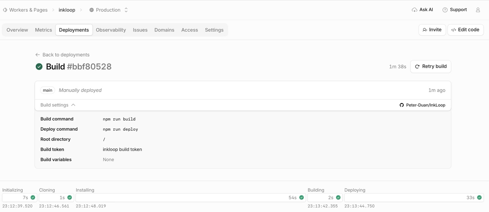
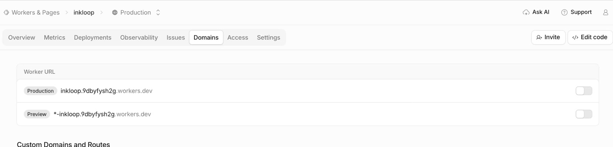
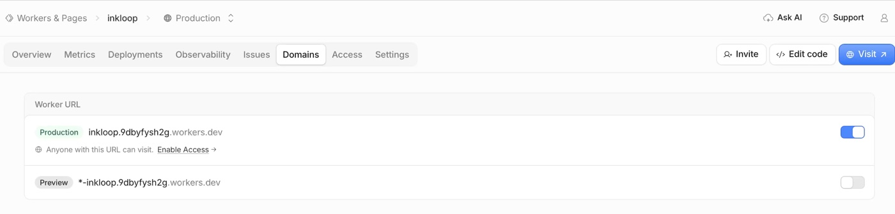
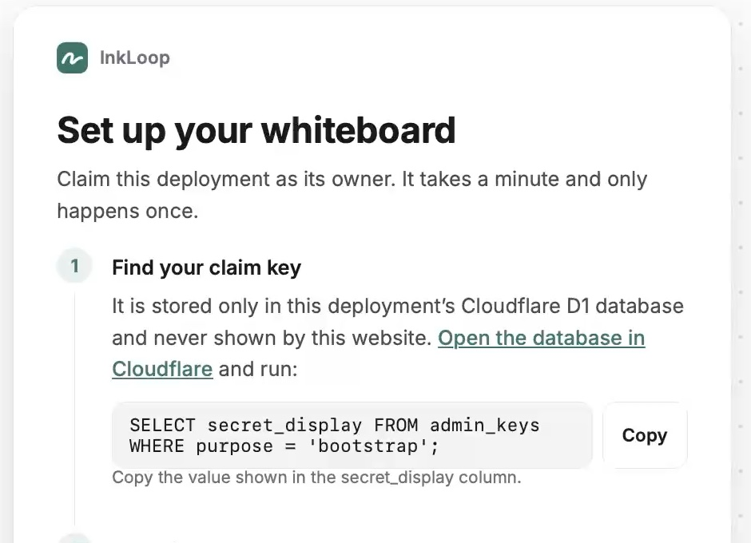
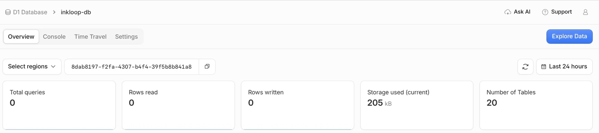
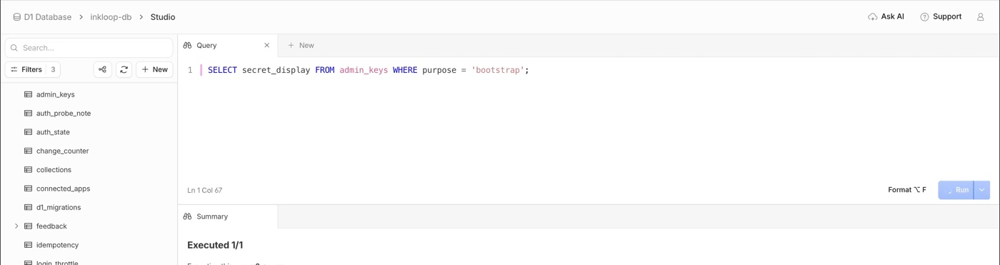
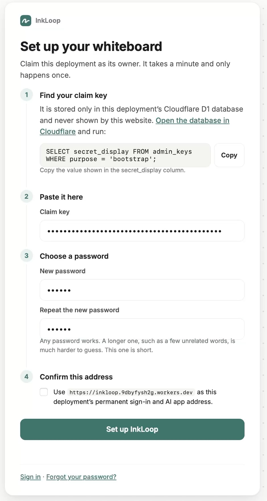
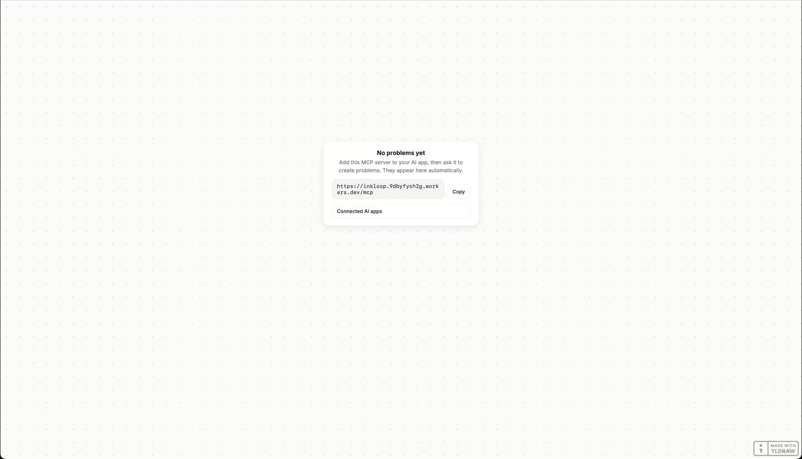

# After deployment: open and claim InkLoop

[中文图文教程](getting-started.zh-CN.md)

Start here after Cloudflare has successfully deployed your fork. R2 must already be enabled for the account; see [deployment prerequisites](deployment.md#enable-r2-before-deploying).

The screenshots are extracted from a real first-install recording. They show an example account and deployment: use your own Worker URL and database. Some wording predates the updated database-link instructions; follow the steps below. The recording's clear-text claim-key result is deliberately omitted. Passwords and the pasted key remain masked.

## 1. Confirm deployment succeeded

Open **Compute → Workers & Pages → your InkLoop Worker → Deployments**. The build should have a green success indicator, including the **Deploying** stage. A successful frontend build alone is not the end of deployment.



## 2. Enable the production URL

Open the Worker's **Domains** tab. Under **Worker URL**, find **Production** and turn on its switch if it is off.



Once enabled, the switch is blue and **Visit** is available in the upper right. **Preview** URLs can remain off. **Enable Access** is a separate Cloudflare Access feature; it is not the switch for the production URL, and is not required for InkLoop's own password sign-in.



Click **Visit**. An unclaimed instance opens its setup page; you can also visit `https://YOUR-WORKER.workers.dev/setup`. Choose the HTTPS address you intend to keep before claiming the instance: sign-in and AI authorization bind to this origin.

## 3. Open the database overview, then Explore Data

On **Set up your whiteboard**, use the Cloudflare database link under **Find your claim key**.



Current builds open the database's **Overview** page, whose URL ends in `/metrics`:

```text
https://dash.cloudflare.com/ACCOUNT_ID/workers/d1/databases/DATABASE_ID/metrics
```

If a database list appears instead, select this instance's database, usually **inkloop-db**. You can also reach it through **Storage & databases → D1 SQLite Database**. If unsure which database belongs to the Worker, check its **DB** binding.

On the database overview, click **Explore Data** in the upper right. This opens **Studio**. Start from this overview rather than bookmarking a direct `/studio` link for first-time access.



Cloudflare may ask you to sign in first. Use the account that owns this deployment; the Cloudflare account and the InkLoop owner password are separate sign-ins. If login leaves a blank page, reopen the database overview or go through the D1 list and select the database again.

## 4. Retrieve the one-time claim key

In Studio's **Query** editor, paste the following and click **Run**:

```sql
SELECT secret_display
FROM admin_keys
WHERE purpose = 'bootstrap';
```



Copy the value in the **secret_display** result cell. Copy only the value, without the column heading or extra quotes. This is the **Claim key** for the setup form. Keep it private.

If Studio does not open, the database's **Console** tab can run the same query with **Execute**. If no key is returned, first open `/setup` once at your Worker address and retry. Also check that you selected the correct database. An already claimed instance uses ordinary sign-in or password recovery, not another bootstrap claim.

## 5. Claim the instance and choose its password

Return to the InkLoop setup tab:

1. Paste the value into **Claim key**.
2. Enter your password in **New password** and again in **Repeat the new password**. A longer password is recommended; use your own password rather than copying the recording's example.
3. Under **Confirm this address**, check that the displayed HTTPS origin is the permanent address you want, then select the checkbox.
4. Click **Set up InkLoop** and wait for completion.



The screenshot is taken before selecting the address checkbox. The claim key proves ownership of this deployment; your new password is what you use for later InkLoop sign-ins. Neither is your Cloudflare account password.

## 6. Confirm the board opens

After setup, InkLoop signs you in and opens the board. A new instance shows **No problems yet**. The one-time bootstrap key is consumed.



The board displays your MCP server URL, `https://YOUR-WORKER.workers.dev/mcp`. Add it to a compatible AI client and approve access there. Setup is complete; returning users sign in at `/login` with the password they chose.

## If you forget the password

Use `/recover` and the **recovery** key, not the consumed bootstrap key. Open the same database **Overview → Explore Data** path and follow [password recovery](deployment.md#recovery-and-connected-applications). Recovery rotates the recovery key and invalidates previous Web sessions and MCP authorizations.
