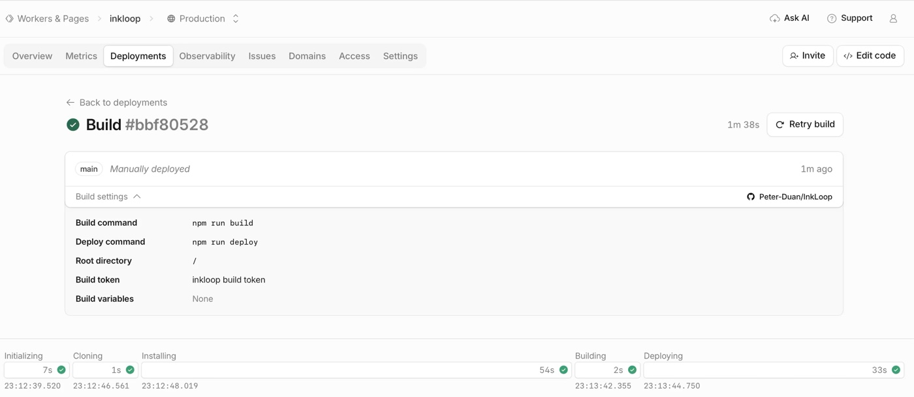
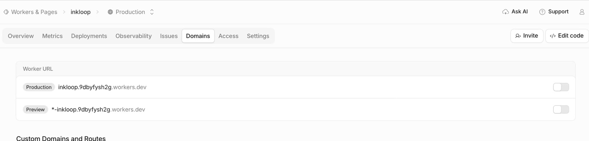
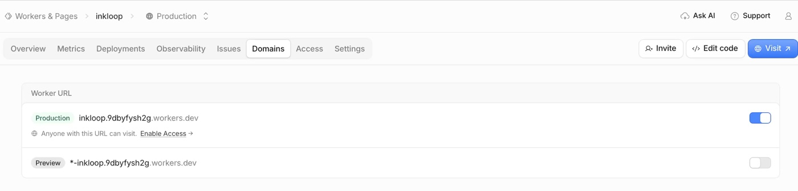
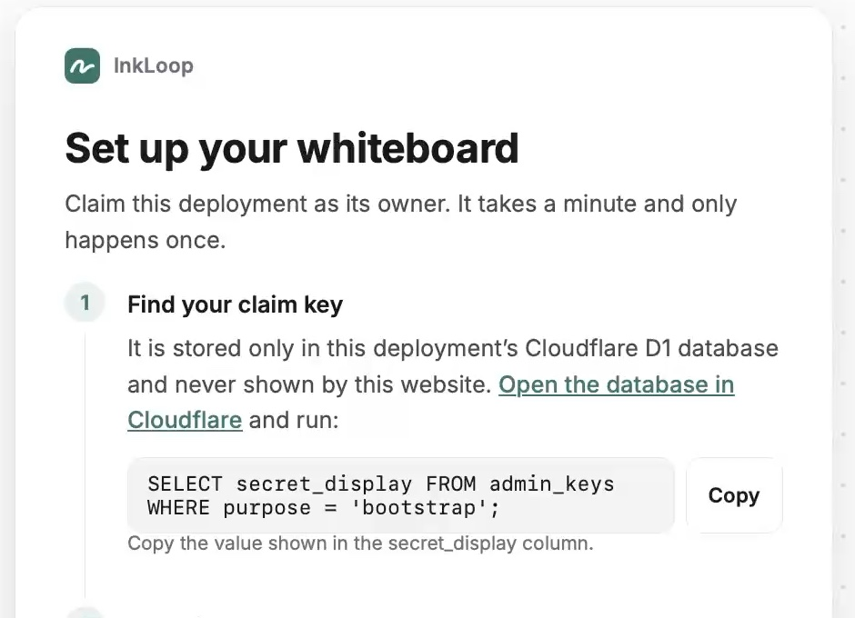
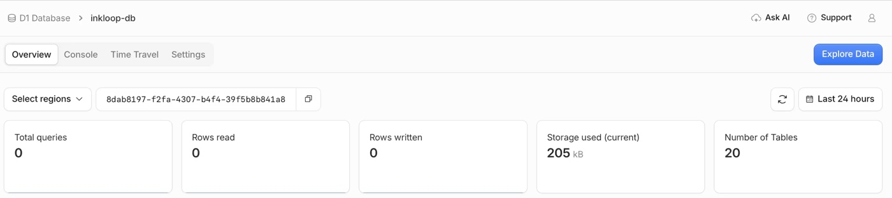
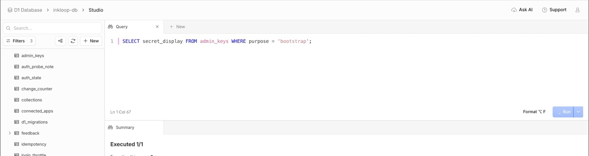
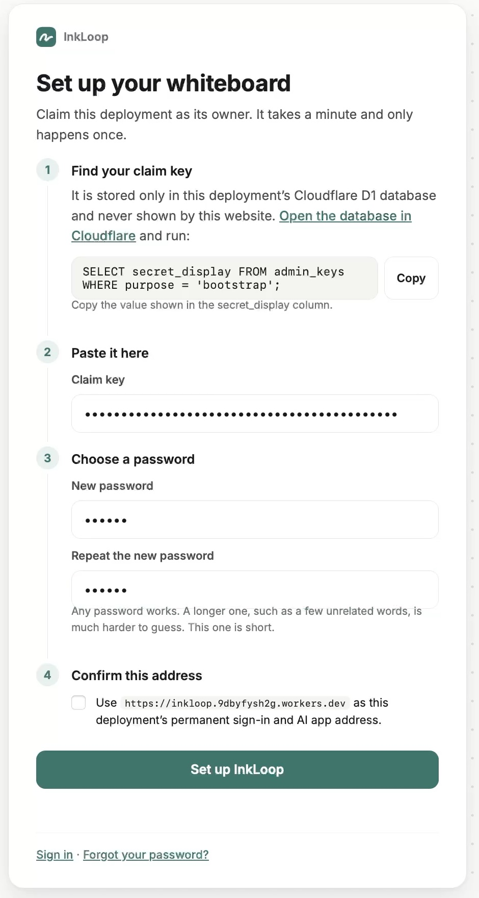
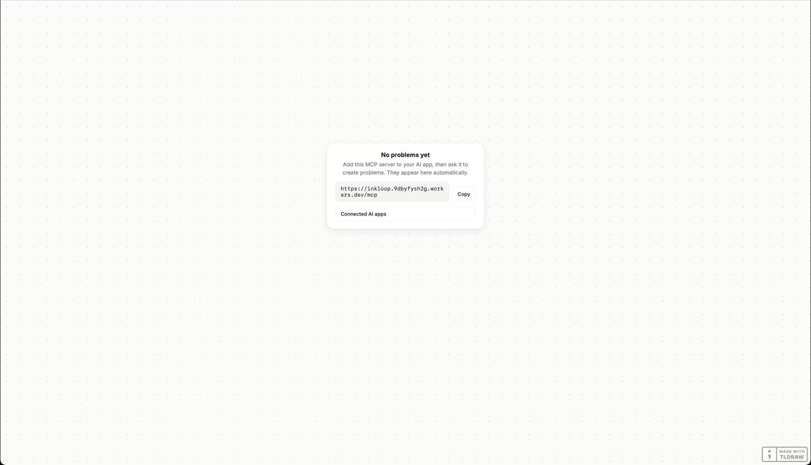

# 部署成功后：启用访问地址、认领实例与设置密码

[English guide](getting-started.md)

本教程从 Cloudflare **Deploy 成功**开始。账号需事先开通 R2，见[部署前置条件](deployment.md#enable-r2-before-deploying)。以下图片取自真实首次部署录屏；截图中的网址和数据库是演示实例，请使用你自己部署的资源。截图可能保留旧版按钮文案，以本文步骤为准。明文 claim key 的结果画面未收录，粘贴后的密钥与密码均保持圆点遮挡。

## 1. 确认部署成功

进入 **Compute → Workers & Pages → 你的 InkLoop Worker → Deployments**。确认构建出现绿色成功标记，且 **Deploying** 阶段也已完成。只完成前端 Build，还不代表部署结束。



## 2. 打开生产访问地址

进入 Worker 顶部的 **Domains** 标签，在 **Worker URL** 下找到 **Production**。如果右侧开关是灰色，将它打开。



启用后，开关变蓝，页面右上角会出现 **Visit** 按钮。**Preview** 可以保持关闭。下方的 **Enable Access** 是另一个 Cloudflare Access 功能，并非启用 URL 的按钮；使用 InkLoop 自身的密码登录不需要开启它。



点击 **Visit**，未认领的实例会进入首次设置页。也可以直接打开：

```text
https://你的Worker地址/setup
```

认领前先确定以后要一直使用的 HTTPS 地址。InkLoop 的登录和 AI 授权会绑定这个地址。

## 3. 从数据库详情进入 Explore Data

在 **Set up your whiteboard** 页面，找到 **Find your claim key** 中的 Cloudflare 数据库链接。



新版链接先进入数据库的 **Overview** 页面，网址以 `/metrics` 结尾：

```text
https://dash.cloudflare.com/账号ID/workers/d1/databases/数据库ID/metrics
```

如果打开的是 D1 列表，选择当前实例的数据库，默认通常叫 **inkloop-db**。也可手动从 **Storage & databases → D1 SQLite Database** 进入。无法确定数据库时，可回到 Worker 查看 **DB** 绑定。

在数据库详情页右上角点击 **Explore Data**，再进入 **Studio**。首次访问按这条路径走，不直接跳到 `/studio`。



如果 Cloudflare 要求登录，请登录拥有这个部署的 Cloudflare 账号。这与稍后设置的 InkLoop 密码是两套登录。如果登录后页面空白，重新打开数据库 Overview，或从 D1 列表重新选择数据库。

## 4. 查询一次性 claim key

在 Studio 的 **Query** 编辑器粘贴下面的 SQL，点击 **Run**：

```sql
SELECT secret_display
FROM admin_keys
WHERE purpose = 'bootstrap';
```



结果会显示 **secret_display** 列。复制该单元格的值，只复制密钥本身，不要带列名或额外引号。这个值就是设置页需要的 **Claim key**，不要公开分享。

如果 Studio 无法打开，也可用数据库详情页的 **Console** 标签执行同一条 SQL，点击 **Execute**。如果查询没有返回密钥，先访问一次你部署的 `/setup`，再查询，并确认选对了数据库。已完成认领的实例应登录或恢复密码，不需要再次领取 bootstrap key。

## 5. 粘贴密钥并设置自己的密码

回到 InkLoop 设置标签页：

1. 将密钥粘贴到 **Claim key**。
2. 在 **New password** 输入你自己的密码，在 **Repeat the new password** 再输入一次。建议使用较长密码，不要照抄录屏里的演示密码。
3. 在 **Confirm this address** 检查显示的 HTTPS 地址，确认是以后要一直使用的地址，再勾选复选框。
4. 点击 **Set up InkLoop**，等待完成。



这张截图截取在勾选地址之前。Claim key 用于证明你有权认领实例，新设置的密码用于以后登录 InkLoop；两者都不是 Cloudflare 账号密码。

## 6. 进入画板即完成

设置成功后会自动登录并打开画板。全新实例显示 **No problems yet**，表示暂时还没有题目；一次性 bootstrap key 此时已被消耗。



页面给出的 `https://你的Worker地址/mcp` 是 AI 客户端连接地址。在支持 MCP 的 AI 客户端中添加它，再批准访问即可。以后登录 InkLoop 使用 `/login` 和刚设置的密码。

## 忘记密码时怎么恢复

1. 打开同一实例的 `/recover`，或在登录页点击 **Forgot your password?**。
2. 打开同一个数据库的 **Overview → Explore Data**。
3. 运行下面的查询，复制 `secret_display` 的值：

   ```sql
   SELECT secret_display
   FROM admin_keys
   WHERE purpose = 'recovery';
   ```

4. 将它粘贴到 **Recovery key**，输入并重复新密码，点击 **Reset password**。
5. 恢复成功后，旧 Web 登录和 MCP 授权会失效，AI 客户端需要重新连接。Recovery key 也会轮换，下次恢复应重新从 D1 查询。

首次认领用 `bootstrap`，密码恢复用 `recovery`。恢复入口也先进入 `/metrics` 数据库详情，再点 **Explore Data**。完整运行说明见[密码恢复与已连接应用](deployment.md#recovery-and-connected-applications)。
